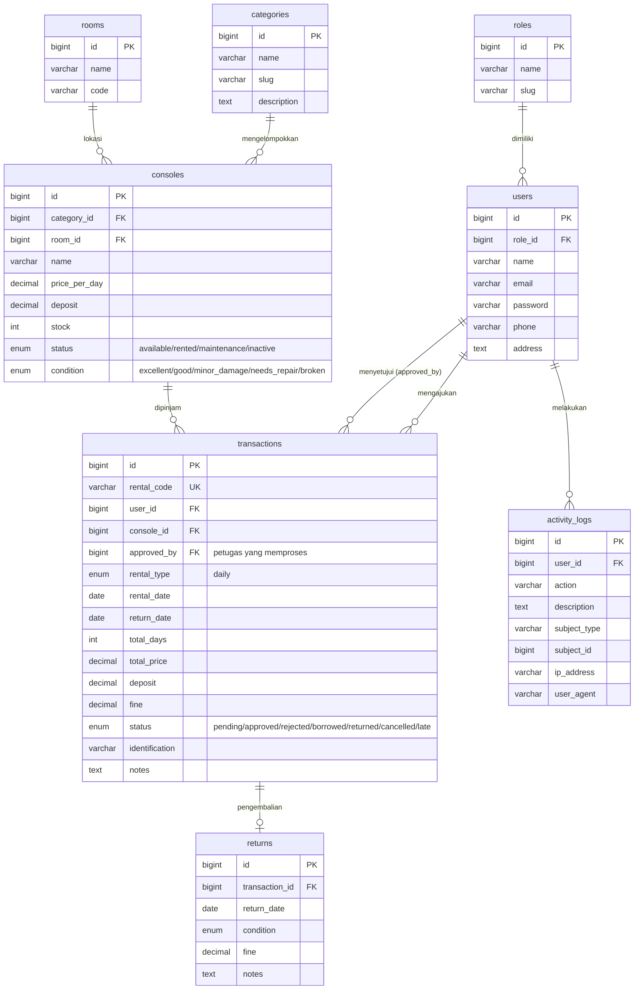
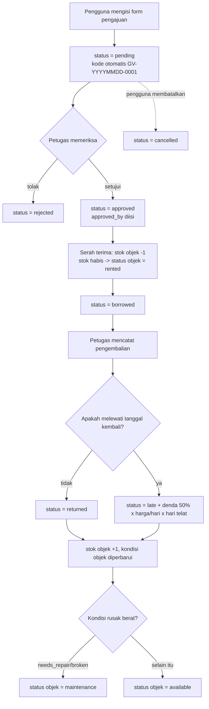

# Dokumentasi Aplikasi Peminjaman Alat

Aplikasi web peminjaman alat/barang untuk praktik **UKK RPL**. Pengguna mengajukan peminjaman, petugas menyetujui dan menyerahkan barang, lalu mencatat pengembalian beserta denda keterlambatan. Admin mengelola data master dan melihat laporan.

---

## 1. Teknologi

| Bagian | Keterangan |
| --- | --- |
| Framework | Laravel (PHP 8.3) |
| Database | MySQL (nama database: `latihan_ukk`) |
| Tampilan | Blade + Bootstrap 5 (template Sneat), ApexCharts untuk grafik |
| Autentikasi | Session login bawaan Laravel |
| Pengujian | Pest (140 tes, 599 assertion, database SQLite `:memory:`) |

---

## 2. Cara Menjalankan

### Pilihan A — dari source code (migrasi + seeder)

```bash
composer install
npm install
cp .env.example .env
php artisan key:generate
php artisan migrate --seed
npm run build
php artisan serve
```

### Pilihan B — dari file dump database

```bash
mysql -u root -e "CREATE DATABASE latihan_ukk"
mysql -u root latihan_ukk < database_peminjaman_alat.sql
```

Isi `database_peminjaman_alat.sql` sudah lengkap: 16 tabel, seluruh data, plus function, procedure, dan trigger.

### Objek database (opsional, ada di dump)

```bash
mysql -u root latihan_ukk < objek_database.sql
```

---

## 3. Akun Demo

Semua password: `password`

| Role | Email |
| --- | --- |
| Admin | budi@gamevault.test |
| Petugas | andi@example.test |
| Pengguna | arrofiryanto@gmail.com |

---

## 4. Hak Akses

| Fitur | Pengguna | Petugas | Admin |
| --- | :---: | :---: | :---: |
| Dashboard | ya | ya | ya |
| Ajukan peminjaman, daftar & detail pengajuan sendiri, batalkan | ya | - | - |
| Persetujuan & serah terima | - | ya | ya |
| Pengembalian & denda | - | ya | ya |
| Laporan peminjaman + cetak + export CSV | - | ya | ya |
| Log aktivitas | - | - | ya |
| Data master (kategori, objek, user) | - | - | ya |

Hak akses dijaga terpusat melalui helper `cekRole()` di `app/Http/Controllers/Controller.php:13` (memakai `abort_unless(..., 403)`).

---

## 5. ERD



---

## 6. Alur Peminjaman



### Pseudocode

**Pengguna mengajukan peminjaman**

```text
MULAI pengajuan
  validasi input (objek, tanggal pinjam, tanggal kembali, identitas)
  ambil data objek
  JIKA stok objek < 1 MAKA tampilkan pesan "stok sedang kosong", SELESAI
  hitung total_hari = selisih tanggal (minimal 1)
  simpan transaksi:
    rental_code = "GV-" + tanggal hari ini + "-" + urutan (4 digit)
    status       = "pending"
    total_price  = harga_per_hari x total_hari
    deposit      = deposit objek
  catat log "create"
  tampilkan pesan sukses
SELESAI
```

**Petugas serah terima objek**

```text
MULAI serah terima
  JIKA status transaksi bukan "approved" MAKA tampilkan pesan error, SELESAI
  JIKA stok objek < 1 MAKA tampilkan pesan "stok kosong", SELESAI
  ubah status transaksi menjadi "borrowed"
  stok objek = stok objek - 1
  JIKA stok objek = 0 DAN status objek = "available" MAKA status objek = "rented"
  catat log "borrow"
SELESAI
```

**Petugas mencatat pengembalian**

```text
MULAI pengembalian
  JIKA status transaksi bukan "borrowed" MAKA tampilkan pesan error, SELESAI
  validasi input (tanggal kembali, kondisi, denda, catatan)
  hari_terlambat = 0
  JIKA tanggal_kembali > tanggal_jatuh_tempo MAKA
     hari_terlambat = selisih hari (selalu positif)
  simpan pengembalian (transaksi_id, tanggal, kondisi, denda, catatan)
  JIKA hari_terlambat > 0 MAKA status transaksi = "late"
  SELAIN ITU status transaksi = "returned"
  simpan denda pada transaksi
  stok objek = stok objek + 1
  kondisi objek = kondisi hasil pengembalian
  JIKA kondisi "needs_repair" atau "broken" MAKA status objek = "maintenance"
  SELAIN JIKA stok > 0 DAN status objek "rented" MAKA status objek = "available"
  catat log "return" (+ keterangan terlambat X hari)
SELESAI
```

---

## 7. Aturan Bisnis

| Aturan | Perhitungan |
| --- | --- |
| Kode peminjaman | `GV-YYYYMMDD-0001`, urutan dimulai dari 1 setiap hari |
| Lama sewa | Hanya harian; selisih tanggal, minimal 1 hari |
| Total harga | `price_per_day × total_days` |
| Denda terlambat | `50% × price_per_day × jumlah hari terlambat` (form menghitung otomatis, petugas boleh mengubah) |
| Denda kerusakan | Persentase deposit: ringan 25%, perlu perbaikan 50%, rusak berat 100% |
| Stok | Berkurang 1 saat serah terima, bertambah 1 saat pengembalian |
| Status objek | `rented` bila stok habis; `maintenance` bila kondisi `needs_repair`/`broken`; selain itu `available` |

---

## 8. Objek Database

Berisi 1 function, 2 procedure, dan 2 trigger (file `objek_database.sql`).

| Objek | Jenis | Fungsi |
| --- | --- | --- |
| `fn_denda_telat(jatuh_tempo, kembali, harga)` | Function | Menghitung denda telat 50% per hari |
| `sp_ringkasan_peminjaman(dari, sampai)` | Procedure | Ringkasan jumlah transaksi, pendapatan, dan denda pada rentang tanggal |
| `sp_pinjam_objek(id_transaksi)` | Procedure | Serah terima: kurangi stok, ubah status, tolak bila stok habis (`SIGNAL`) |
| `trg_transactions_fine_non_negative` | Trigger | Denda minus otomatis menjadi 0 saat update |
| `trg_transactions_kode_wajib` | Trigger | Menolak transaksi baru tanpa kode peminjaman (`SIGNAL`) |

Hasil pengujian objek database pada data nyata:

| Uji | Perintah | Hasil |
| --- | --- | --- |
| Function tepat waktu | `fn_denda_telat('2026-10-10','2026-10-10',50000)` | `0.00` |
| Function telat 2 hari | `fn_denda_telat('2026-10-10','2026-10-12',50000)` | `50000.00` |
| Procedure ringkasan | `sp_ringkasan_peminjaman('2026-01-01','2026-12-31')` | 14 transaksi, pendapatan 1.420.000, denda 400.000 |
| Procedure serah terima | `sp_pinjam_objek(6)` | status `borrowed`, stok 1 → 0 |
| Procedure stok habis | `sp_pinjam_objek` pada objek stok 0 | error "Stok objek habis, tidak bisa dipinjam" |
| Trigger denda minus | `UPDATE ... SET fine = -100000` | nilai tersimpan `0.00` |
| Trigger kode kosong | `INSERT transactions` tanpa kode | error "Kode peminjaman wajib diisi" |

---

## 9. Commit dan Rollback

Bukti uji ada pada file `demo_transaksi.sql`:

| Perintah | Hasil |
| --- | --- |
| `START TRANSACTION` + `INSERT` kategori + `ROLLBACK` | jumlah data `uji-rollback` = 1 saat di dalam transaksi, menjadi 0 setelah rollback |
| `START TRANSACTION` + `INSERT` kategori + `COMMIT` | jumlah data `uji-commit` = 1 dan tersimpan permanen |

---

## 10. Skenario Pengujian

Diuji langsung lewat browser/aplikasi yang berjalan (`php artisan serve`) dengan data nyata.

### Skenario 1 — Login dan Dashboard

| Langkah | Hasil yang diharapkan | Hasil |
| --- | --- | --- |
| Buka `/login` | Form email & password tampil | Sesuai (HTTP 200) |
| Login dengan password salah | Pesan "Email atau password salah." | Sesuai |
| Login pengguna `arrofiryanto@gmail.com` | Dashboard Pengguna | Sesuai (HTTP 200) |
| Login petugas `andi@example.test` | Dashboard Petugas | Sesuai (HTTP 200) |
| Logout | Kembali ke halaman login + log tersimpan | Sesuai |

### Skenario 2 — Pengajuan Peminjaman (pengguna)

| Langkah | Hasil yang diharapkan | Hasil |
| --- | --- | --- |
| Buka form pengajuan | Daftar objek yang stoknya tersedia | Sesuai |
| Kirim pengajuan objek "PS5 Digital Edition" 2 hari | Tersimpan status `pending` | Sesuai, kode `GV-20261017-0001` |
| Buka daftar & detail pengajuan | Data tampil dengan kode tersebut | Sesuai |
| Pengguna membuka `/persetujuan` | Ditolak | Sesuai (HTTP 403) |

### Skenario 3 — Persetujuan dan Serah Terima (petugas)

| Langkah | Hasil yang diharapkan | Hasil |
| --- | --- | --- |
| Buka `/persetujuan` | Pengajuan `pending` tampil | Sesuai |
| Cari dengan kode `GV-20261017-0001` | Hanya data tersebut tampil | Sesuai |
| Klik Setujui | status `approved`, `approved_by` terisi | Sesuai, `approved_by = 24` |
| Klik Serah Terima | status `borrowed`, stok berkurang 1 | Sesuai, stok 2 → 1 |

### Skenario 4 — Pengembalian dan Denda (petugas)

| Langkah | Hasil yang diharapkan | Hasil |
| --- | --- | --- |
| Buka `/pengembalian` | Peminjaman berjalan tampil | Sesuai |
| Buka form pengembalian | Data peminjaman & objek tampil | Sesuai |
| Kirim pengembalian 3 hari terlambat, kondisi lecet ringan | status `late`, denda 67.500 | Sesuai, denda `67500.00` |
| Periksa objek | stok kembali, kondisi & status diperbarui | Sesuai, stok 2 → 1 → 2, kondisi `minor_damage`, status `available` |
| Periksa tabel `returns` | 1 baris pengembalian tersimpan | Sesuai |

Perhitungan denda: 50% × 45.000 × 3 hari = **67.500**.

### Skenario 5 — Laporan, Cetak, Export, dan Log Aktivitas

| Langkah | Hasil yang diharapkan | Hasil |
| --- | --- | --- |
| Buka `/laporan` | Ringkasan total tampil | Sesuai |
| Filter tanggal + status `late` | Hanya data sesuai filter | Sesuai, transaksi uji tampil |
| Buka `/laporan/cetak` | Halaman siap cetak, tanpa sidebar | Sesuai |
| Klik Export CSV | Berkas `laporan-peminjaman.csv` terunduh | Sesuai (`text/csv`) |
| Admin buka `/log-aktivitas` | Log `create`, `approve`, `borrow`, `return` tampil | Sesuai |
| Petugas buka `/log-aktivitas` | Ditolak | Sesuai (HTTP 403) |

Log aktivitas yang tercatat untuk transaksi uji:

```text
create   Mengajukan peminjaman GV-20261017-0001
approve  Menyetujui pengajuan GV-20261017-0001
borrow   Serah terima objek untuk GV-20261017-0001
return   Pengembalian objek untuk GV-20261017-0001 (terlambat 3 hari)
```

---

## 11. Pengujian Otomatis

```bash
php artisan test --compact
```

Hasil: **140 tes, 599 assertion, semuanya lolos.**

| Berkas tes | Fokus | Jumlah tes |
| --- | --- | --- |
| `AuthTest` | Login, logout, akses tamu | 11 |
| `DashboardTest` | Dashboard per role, grafik, objek populer | 6 |
| `CategoryTest` | CRUD kategori | 11 |
| `ConsoleTest` | CRUD objek, validasi | 15 |
| `UserTest` | CRUD user, password, role | 17 |
| `TransactionTest` | Pengajuan, batalkan, akses detail | 19 |
| `ApprovalTest` | Setujui, tolak, serah terima | 14 |
| `ReturnTest` | Pengembalian, denda, kondisi objek | 18 |
| `ActivityLogTest` | Log aktivitas & filter | 8 |
| `ReportTest` | Laporan & halaman cetak | 8 |
| `SearchTest` | Pencarian di setiap daftar | 7 |
| `ExportTest` | Export CSV & filternya | 4 |
| `ExampleTest` | Dasar | 1 |

---

## 12. Perintah CLI yang Dipakai

### Membuat berkas dengan Artisan

```bash
# model + migration
php artisan make:model Role -m
php artisan make:model Category -m
php artisan make:model Room -m
php artisan make:model Console -m
php artisan make:model Transaction -m
php artisan make:model ReturnItems -m
php artisan make:model ActivityLog -m
php artisan make:migration add_role_fields_to_users_table --table=users

# controller
php artisan make:controller AuthController
php artisan make:controller DashboardController
php artisan make:controller CategoryController --resource
php artisan make:controller ConsoleController --resource
php artisan make:controller UserController --resource
php artisan make:controller TransactionController
php artisan make:controller ApprovalController
php artisan make:controller ReturnController
php artisan make:controller ReportController
php artisan make:controller ActivityLogController

# seeder dan factory
php artisan make:seeder RoleSeeder
php artisan make:seeder UserSeeder
php artisan make:seeder CategorySeeder
php artisan make:seeder RoomSeeder
php artisan make:seeder ConsoleSeeder
php artisan make:seeder TransactionSeeder
php artisan make:seeder ReturnSeeder
php artisan make:seeder ActivityLogSeeder
php artisan make:factory CategoryFactory --model=Category
php artisan make:factory ConsoleFactory --model=Console
php artisan make:factory TransactionFactory --model=Transaction
php artisan make:factory UserFactory --model=User

# tes (Pest)
php artisan make:test --pest AuthTest
php artisan make:test --pest DashboardTest
php artisan make:test --pest CategoryTest
php artisan make:test --pest ConsoleTest
php artisan make:test --pest UserTest
php artisan make:test --pest TransactionTest
php artisan make:test --pest ApprovalTest
php artisan make:test --pest ReturnTest
php artisan make:test --pest ActivityLogTest
php artisan make:test --pest ReportTest
php artisan make:test --pest SearchTest
php artisan make:test --pest ExportTest

# view
php artisan make:view auth.login
php artisan make:view dashboard.admin
php artisan make:view categories.index
php artisan make:view partials.badge-status
```

Catatan: tabel pengembalian bernama `returns` karena `return` adalah kata kunci PHP, maka modelnya `ReturnItems` dengan `protected $table = 'returns';`.

### Menjalankan dan memeriksa

```bash
php artisan migrate --seed                # struktur tabel + data awal
php artisan db:seed --class=RoleSeeder    # seeder tertentu saja
php artisan serve                         # jalankan aplikasi
php artisan route:list                    # daftar route
php artisan config:show app.name          # lihat konfigurasi
php artisan test --compact                # jalankan semua tes
vendor/bin/pint --dirty                   # rapikan format kode PHP
```

### Database mentah (MySQL)

```bash
mysql -u root latihan_ukk < objek_database.sql       # function, procedure, trigger
mysql -u root latihan_ukk < demo_transaksi.sql       # demo COMMIT dan ROLLBACK
mysqldump -u root --routines --triggers latihan_ukk > database_peminjaman_alat.sql
```

Pada Windows PowerShell gunakan `--result-file` agar hasil dump tidak ber-encoding UTF-16:

```powershell
mysqldump -u root --routines --triggers --result-file="database_peminjaman_alat.sql" latihan_ukk
```

---

## 13. Struktur File Penting

| Berkas | Isi |
| --- | --- |
| `routes/web.php` | Seluruh route aplikasi |
| `app/Http/Controllers/Controller.php` | Helper `cekRole()` dan `catatLog()` |
| `app/Http/Controllers/AuthController.php` | Login, logout, log aktivitas |
| `app/Http/Controllers/DashboardController.php` | Dashboard per role, grafik, objek populer |
| `app/Http/Controllers/CategoryController.php` | CRUD kategori |
| `app/Http/Controllers/ConsoleController.php` | CRUD objek |
| `app/Http/Controllers/UserController.php` | CRUD user |
| `app/Http/Controllers/TransactionController.php` | Pengajuan peminjaman pengguna |
| `app/Http/Controllers/ApprovalController.php` | Persetujuan dan serah terima |
| `app/Http/Controllers/ReturnController.php` | Pengembalian dan denda |
| `app/Http/Controllers/ReportController.php` | Laporan, cetak, export CSV |
| `app/Http/Controllers/ActivityLogController.php` | Log aktivitas |
| `resources/views/` | Semua tampilan Blade per fitur |
| `database/migrations/` | Struktur tabel |
| `database/seeders/` | Data awal |
| `objek_database.sql` | Function, procedure, trigger |
| `demo_transaksi.sql` | Demo commit & rollback |
| `database_peminjaman_alat.sql` | Dump lengkap database |

---

## 14. Catatan

- Menu sidebar menyesuaikan role sehingga pengguna tidak melihat menu petugas/admin.
- Perubahan data penting (login, ajukan, setujui, tolak, serah terima, kembali, batalkan, CRUD master) selalu dicatat ke tabel `activity_logs`.
- Kata `condition` adalah reserved word MySQL sehingga perlu backtick saat ditulis dalam SQL mentah.
